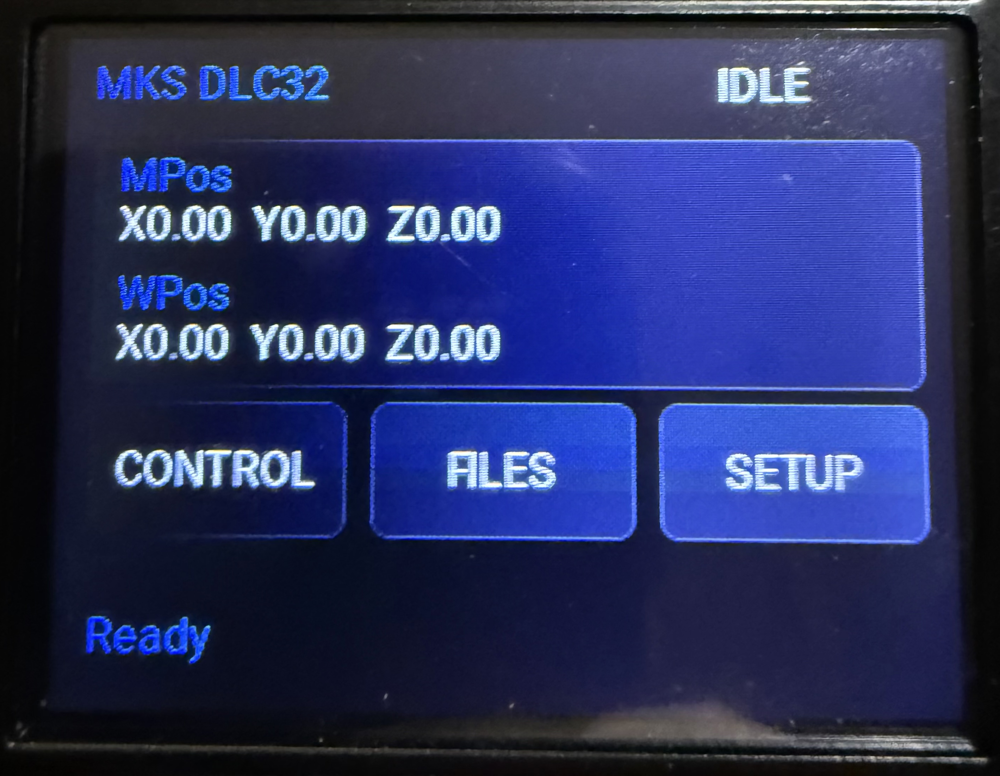
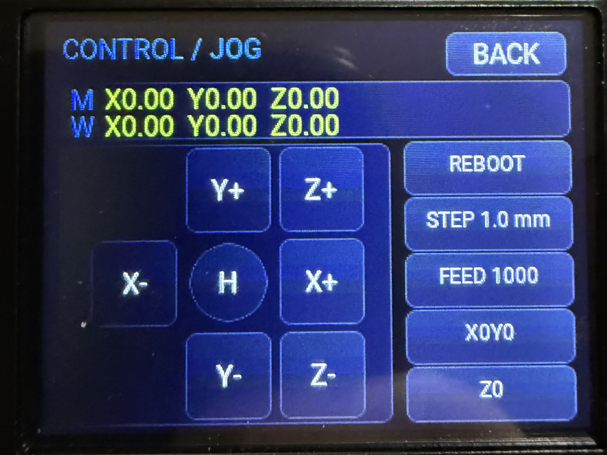
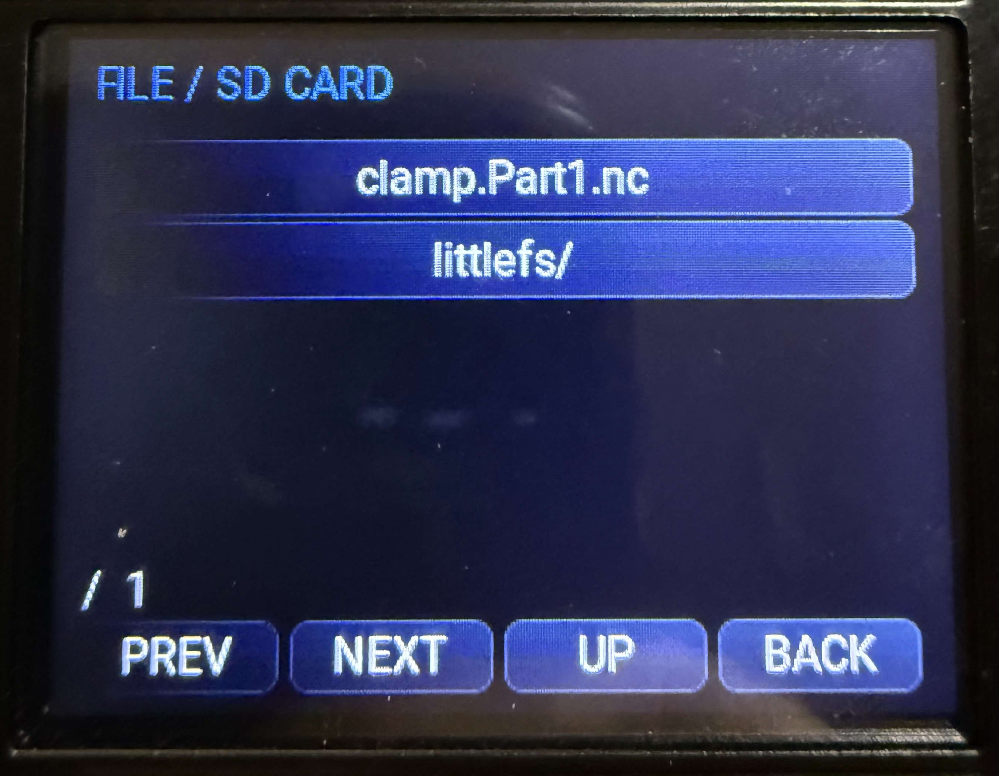
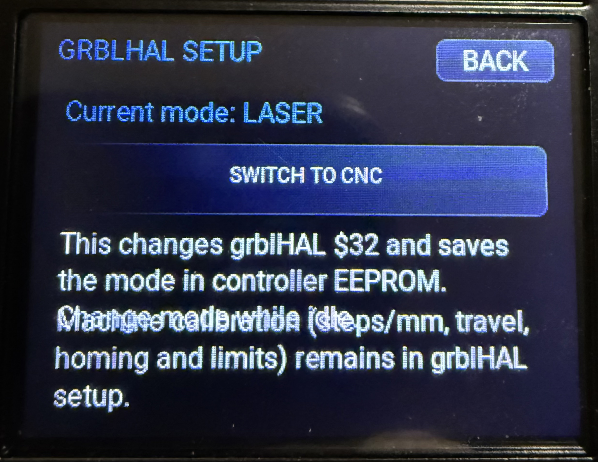

# grblHAL for MKS DLC32 V2.2 with TS24-R

This repository adds an experimental LVGL touchscreen interface for the MKS DLC32 V2.2 controller and MKS TS24-R V2.1 display. It is based on the grblHAL ESP32 driver and is configured for the standard MKS DLC32 V2.0 board map.

The UI provides live machine/work position readouts, jogging, homing, work zeroing, an SD-card file browser, job controls, and CNC/Laser mode selection. The TS24 display and touch panel have been brought up on the controller; machine motion and job execution have not been verified on a connected CNC machine.

## Screenshots

### Home



### Control and jog



### SD card file browser



### grblHAL setup



## Build and flash

Build with ESP-IDF v4.3 in the configured ESP-IDF environment:

```text
idf.py -D MKS_TS24_UI=ON -D MKS_TS24_UI_SAFE_BRINGUP=OFF build
```

The build creates `build/grbl.bin`. The flash size must be set to 8 MB for the DLC32. To flash the full image set with ESP-IDF, use `idf.py -p COMx flash`; the tool writes the bootloader at `0x1000`, partition table at `0x8000`, and application at `0x10000`.

The release ZIP provided with this project contains the application image renamed to `firmware.bin`; flash it at `0x10000` when using a tool that accepts an image and address. It does not contain the bootloader or partition table.

`MKS_TS24_UI_SAFE_BRINGUP` is intentionally OFF for the regular build. The TS24 uses pins that overlap some DLC32 auxiliary functions; review the board map and TS24 notes in [`main/ts24_ui/README.md`](main/ts24_ui/README.md) before connecting a machine. Axis steps/mm, travel, homing, and limits are configured through grblHAL.

The local changes required in the `main/grbl` submodule are recorded in [`patches/grblhal-core-ts24.patch`](patches/grblhal-core-ts24.patch). After initializing submodules, apply it from the project root with:

```text
git -C main/grbl apply ../..\patches\grblhal-core-ts24.patch
```

---

## ESP32 grblHAL driver

__Important:__  
If enabling ftp upload to the SD card then _ffconf.h_ in the ESP SDK has to be edited, `#define FF_FS_RPATH` must be changed to 2 or you will get a compiler error.  
_ffconf.h_ is located in the subfolder _esp-idf\components\fatfs\src_ in the ESP32 SDK installation. The ESP32 SDK is typically installed in the user folder.

This driver can be built with the [Web Builder](http://svn.io-engineering.com:8080/?driver?driver=ESP32).

### How to build using ESP-IDF v4.3:

While this manual briefly describes basic build process on Linux OS, you can find more details
as well as differences for building on other OS at this webpage:

https://docs.espressif.com/projects/esp-idf/en/latest/esp32/get-started/index.html#step-2-get-esp-idf

First you have to prepare esp-idf v4.3:

```bash
#Create directory and clone esp-idf into it:
mkdir -p ~/esp
cd ~/esp
git clone -b release/v4.3 --recursive --shallow-submodules https://github.com/espressif/esp-idf.git

#Prepare build environment and toolchain:
cd ~/esp/esp-idf
./install.sh
. ~/esp/esp-idf/export.sh
```

Then get the grblHAL driver code:

```bash
#Create directory and clone the ESP32 grblHAL driver into it:
git clone --recursive https://github.com/grblHAL/ESP32.git
```

Go into the `ESP32/main` directory and modify settings in `grbl/config.h` and `CMakeLists.txt` as needed.
Pin assignments and board specific config is in `*_map.h` files for each individual board.

Run `idf.py build` from the `ESP32` directory.
This will build the firmware image which can be later flashed into ESP32 device.

Note that `idf.py` command is only available in terminal window which was previously configured
using the `. ~/esp/esp-idf/export.sh` command.

After build is completed you will be instructed on how to flash firmware into the device.
Typically you can use command similar to this: `idf.py -p /dev/ttyUSB0 flash`

Once flashing is complete, your CNC controller is ready to be configured and used.


### Using Docker

If you're familiar with [Docker](https://docker.io), you can use it to build grblHAL in a self-contained environment without installing the complete toolchain on your system:

- prepare and configure the codebase as described above
- build with `docker run -it --rm -v $(pwd):/grbl -w /grbl espressif/idf:release-v4.3 idf.py build`
- flash with `docker run -it --rm -v $(pwd):/grbl --privileged -v /dev:/dev -w /grbl/drivers/ESP32 espressif/idf:release-v4.3 idf.py -p /dev/ttyUSB0 flash`

### Building with user defined plugin

The file containing `my_plugin_init()` has to be added to _CMakeLists.txt_ in the [SRCS list](https://github.com/grblHAL/ESP32/blob/38dde1140d885fc847a0fa9c643cddd3fb1d02f4/main/CMakeLists.txt#L162)
and [grbl/my_plugin.c](https://github.com/grblHAL/ESP32/blob/38dde1140d885fc847a0fa9c643cddd3fb1d02f4/main/CMakeLists.txt#L178) has to be removed from it to be linked correctly.

### Changelog/Notes:

---

__NOTE:__ _grbl/config.h_ or _CMakeLists.txt_ may need modification before compilation. If needed an `#error` (with instructions) will be generated when compiling.


__NOTE:__ Configuration has been simplified a bit, primarily change options in [`CMakeLists.txt`](https://github.com/grblHAL/ESP32/blob/master/main/CMakeLists.txt) to enable/disable.
Configuration of options in _my_machine.h_ is turned off in _CMakeLists.txt_ by default due to this.


---

### Credits:

index.htm.gz is Copyright (c) 2019 Luc Lebosse - from his [ESP3D-WEBUI](https://github.com/luc-github/ESP3D-webui), I may have pulled a few lines from his backend code too.

dns_server.c is Copyright (c) 2019 Tony Pottier - from his [ESP32 WiFi Manager](https://github.com/tonyp7/esp32-wifi-manager) 

Snippets of code is extracted from Espressif ESP-IDF examples which are public domain.

---
2023-09-20

